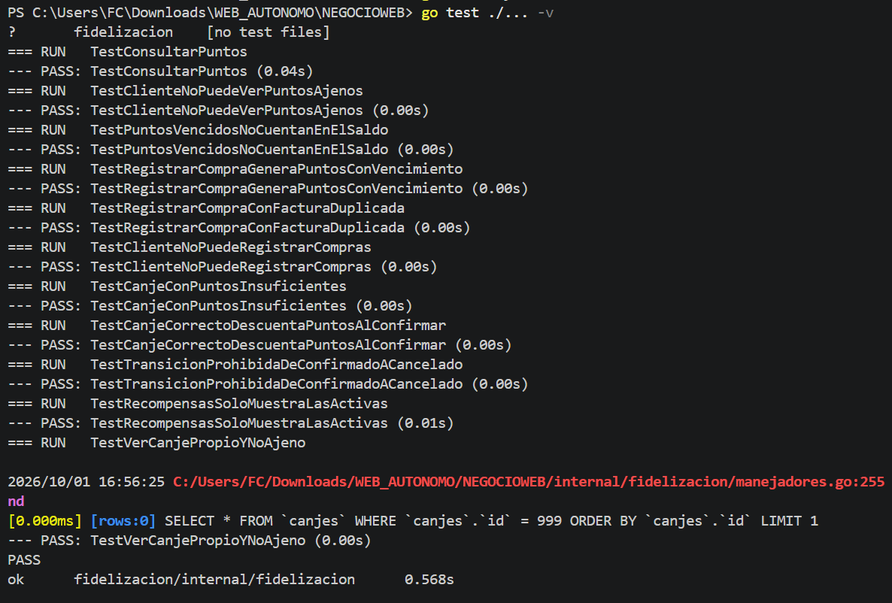
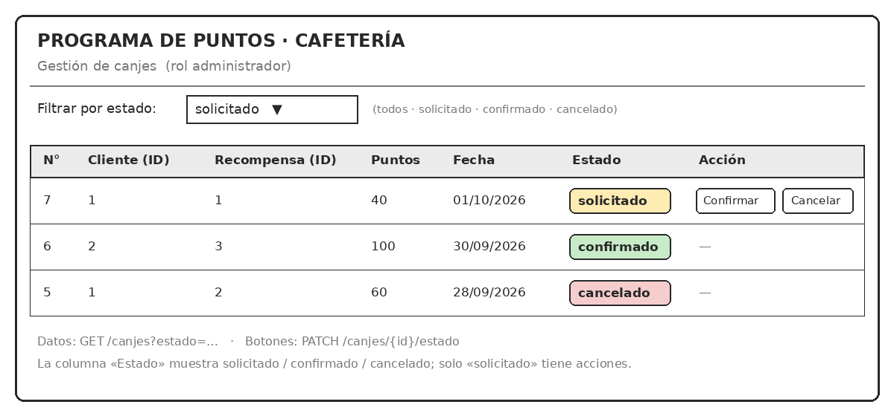
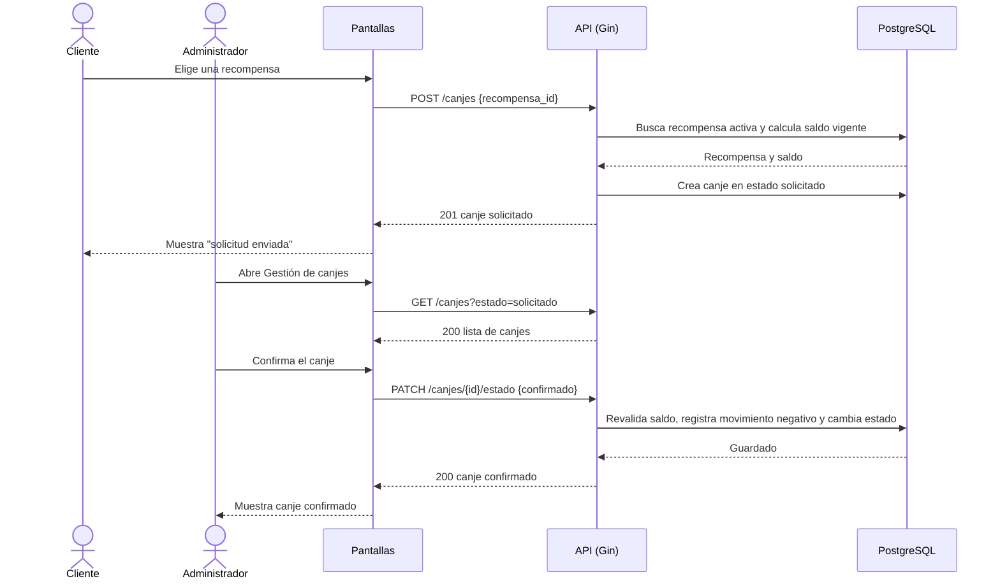
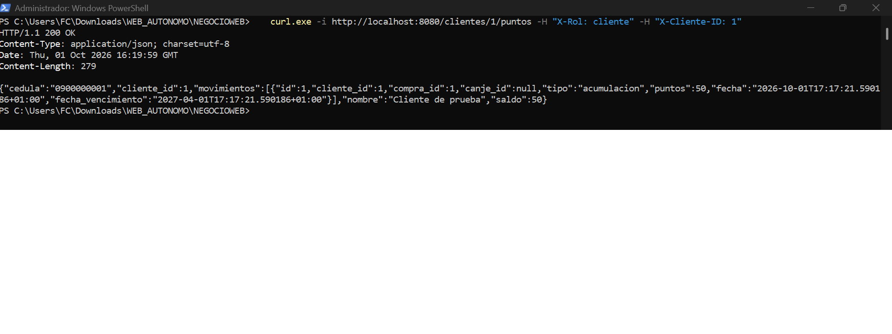
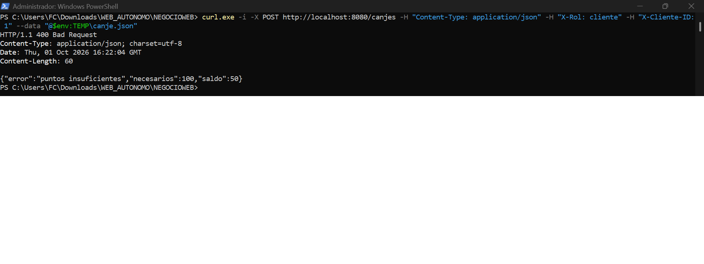

# Hito 1 · Addendum técnico

**Pareja:** Fuentes Cedeño José Miguel · Anchundia Anchundia Luis Antonio
**Paralelo:** Aplicaciones Web II A

## A. Estructura del proyecto

```text
.
├── main.go
├── go.mod
├── go.sum
├── .gitignore
├── .env.example
├── internal/
│   └── fidelizacion/
│       ├── modelos.go
│       ├── db.go
│       ├── manejadores.go
│       ├── rutas.go
│       └── fidelizacion_test.go
└── docs/
    ├── hito1_ficha_del_negocio.md
    ├── hito1_addendum.md
    ├── hito1_presentacion.pdf
    └── (capturas .png)
```

| Carpeta / archivo | Qué guarda |
| --- | --- |
| `main.go` | Lee `.env`, se conecta a PostgreSQL, migra las tablas, carga datos de ejemplo y arranca el servidor en el puerto 8080. |
| `go.mod`, `go.sum` | Módulo `fidelizacion` y sus dependencias (Gin, GORM, controlador de PostgreSQL, godotenv). |
| `.gitignore` | Evita subir `.env` y binarios. |
| `.env.example` | Variables de configuración con valores de ejemplo, sin credenciales reales. |
| `internal/fidelizacion/modelos.go` | Los cinco structs, las constantes de estados, tipos y roles, y las reglas del programa (puntos por dólar y vigencia). |
| `internal/fidelizacion/db.go` | Conexión a PostgreSQL, migración con GORM y datos de ejemplo. |
| `internal/fidelizacion/manejadores.go` | Los siete manejadores de endpoints, el control de rol y el cálculo del saldo. |
| `internal/fidelizacion/rutas.go` | Registro de las rutas y qué rol puede llamar a cada una. |
| `internal/fidelizacion/fidelizacion_test.go` | Las pruebas automáticas. |
| `docs/` | Ficha, addendum, presentación y capturas del hito. |

## B. Configuración y secretos

El proyecto lee las credenciales de la base de datos desde variables de entorno, cargadas de un archivo .env que no se sube al repositorio (está en .gitignore). El archivo de ejemplo es .env.example.

| Variable | Para qué sirve | Ejemplo (sin datos reales) |
| --- | --- | --- |
| `DB_HOST` | Servidor de PostgreSQL | `localhost` |
| `DB_PORT` | Puerto de PostgreSQL | `5432` |
| `DB_USER` | Usuario de la base de datos | `usuario_prueba` |
| `DB_PASSWORD` | Contraseña de la base de datos | `cambiar_esta_clave` |
| `DB_NAME` | Nombre de la base de datos | `fidelizacion_db` |

**Archivo de ejemplo:** `.env.example`

```env
DB_HOST=localhost
DB_PORT=5432
DB_USER=usuario_prueba
DB_PASSWORD=cambiar_esta_clave
DB_NAME=fidelizacion_db
```

## C. Pruebas

Son 11 pruebas en `internal/fidelizacion/fidelizacion_test.go`. Cada una crea su propia base en memoria.

| Prueba | Qué caso cubre |
| --- | --- |
| `TestConsultarPuntos` | El cliente consulta su saldo (acumulación menos canje) y recibe `200`. |
| `TestClienteNoPuedeVerPuntosAjenos` | Un cliente que pide los puntos de otro recibe `403`. |
| `TestPuntosVencidosNoCuentanEnElSaldo` | Los puntos con fecha de vencimiento pasada no suman al saldo. |
| `TestRegistrarCompraGeneraPuntosConVencimiento` | Una compra de $50.75 genera 50 puntos con vencimiento a seis meses. |
| `TestRegistrarCompraConFacturaDuplicada` | La misma factura registrada dos veces responde `409`. |
| `TestClienteNoPuedeRegistrarCompras` | El rol cliente no puede usar `POST /compras` (`403`). |
| `TestCanjeConPuntosInsuficientes` | Un canje sin saldo suficiente responde `400` "puntos insuficientes". |
| `TestCanjeCorrectoDescuentaPuntosAlConfirmar` | Solicitar crea el canje sin descontar; confirmar descuenta los puntos. |
| `TestTransicionProhibidaDeConfirmadoACancelado` | Pasar de `confirmado` a `cancelado` responde `409`. |
| `TestRecompensasSoloMuestraLasActivas` | El catálogo no incluye recompensas inactivas. |
| `TestVerCanjePropioYNoAjeno` | `GET /canjes/{id}`: el cliente ve su canje (`200`), no el de otro (`403`); un canje inexistente da `404`. |

Comando:

```bash
go test ./...
```

**Captura de `go test ./...`:** 

## D. Boceto de la pantalla principal

La pantalla principal es **Gestión de canjes** (rol administrador). Consume `GET /canjes` (el endpoint de listado, con el filtro `?estado=`). Muestra una fila por canje con su número, el cliente, la recompensa, los puntos, la fecha y el **estado** (columna resaltada). Los canjes en `solicitado` tienen los botones Confirmar y Cancelar, que llaman a `PATCH /canjes/{id}/estado`; los demás estados no tienen acciones.

```text
┌─────────────────────────────────────────────────────────────────────────────────────────────────┐
│  PROGRAMA DE PUNTOS · CAFETERÍA     GESTIÓN DE CANJES (administrador)                           │
├─────────────────────────────────────────────────────────────────────────────────────────────────┤
│  Filtrar por estado: [ solicitado ▼ ]      (todos · solicitado · confirmado · cancelado)        │
├────┬──────────────┬─────────────────┬────────┬────────────┬────────────┬────────────────────────┤
│ N° │ Cliente (ID) │ Recompensa (ID) │ Puntos │ Fecha      │ Estado     │ Acción                 │
├────┼──────────────┼─────────────────┼────────┼────────────┼────────────┼────────────────────────┤
│ 7  │ 1            │ 1               │ 40     │ 01/10/2026 │ solicitado │ [Confirmar] [Cancelar] │
│ 6  │ 2            │ 3               │ 100    │ 30/09/2026 │ confirmado │ —                      │
│ 5  │ 1            │ 2               │ 60     │ 28/09/2026 │ cancelado  │ —                      │
└────┴──────────────┴─────────────────┴────────┴────────────┴────────────┴────────────────────────┘
```



## E. Diagrama de secuencia del caso de uso principal

El caso de uso principal es el ciclo completo de un canje: el cliente solicita una recompensa y el administrador la confirma.



## F. Capturas de respuestas

Las dos capturas se toman con curl o Bruno contra el servidor corriendo. Se envía el rol en el encabezado `X-Rol` (y `X-Cliente-ID` para el cliente).

**Caso correcto:** 

```bash
curl -i http://localhost:8080/clientes/1/puntos -H "X-Rol: cliente" -H "X-Cliente-ID: 1"
```

Resultado esperado: `HTTP/1.1 200 OK` con un JSON que incluye `cliente_id`, `cedula`, `nombre`, `saldo` y `movimientos`.

**Caso con error de validación:** 

El cliente pide una recompensa que cuesta más puntos de los que tiene:

```bash
curl -i -X POST http://localhost:8080/canjes \
  -H "Content-Type: application/json" -H "X-Rol: cliente" -H "X-Cliente-ID: 1" \
  -d '{"recompensa_id": 3}'
```

Resultado esperado: `HTTP/1.1 400 Bad Request` con `{"error":"puntos insuficientes","necesarios":100,"saldo":...}`.
