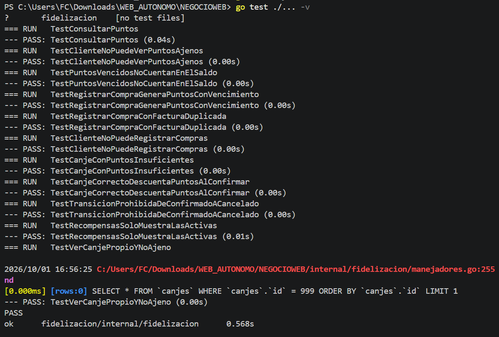
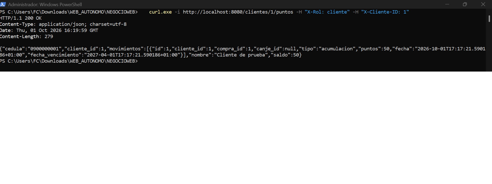
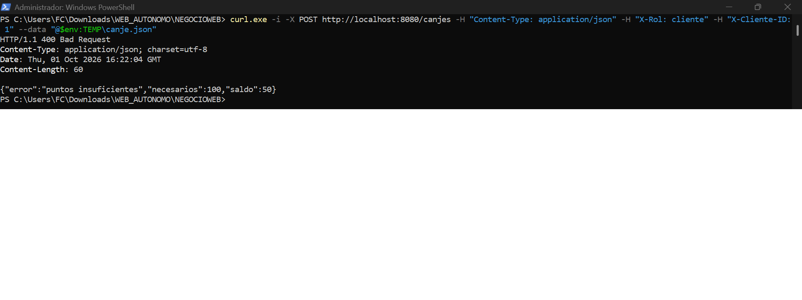
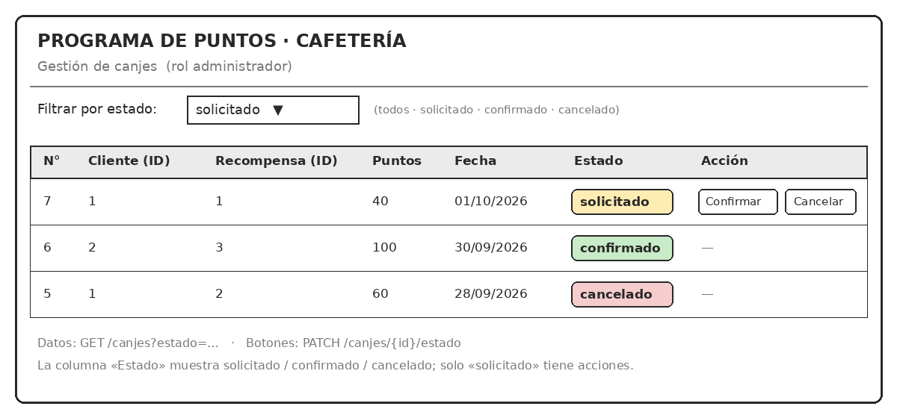

# [Nombre del producto]

> Reemplacen todo lo que está entre corchetes en su primer commit.
> Este README es la puerta de entrada del repositorio: en la semana 1 otra pareja debe poder levantar el servidor siguiendo solo lo que dice aquí, y desde la semana 4 es la base de la integración continua.

**Hilo Servidor · ULEAM · Período 2026-2**
Aplicaciones Web II (TDI-610) · Aplicación para el Servidor Web (IS-503)

# LealCafé · Sistema web de fidelización por puntos

API en Go para un programa de fidelización de clientes. El administrador registra las compras, el cliente acumula puntos, consulta su historial y solicita recompensas, y el administrador confirma o cancela cada canje.

**Primera versión:** una sola cafetería, adaptable después a otros comercios pequeños.
**Referencia ecuatoriana:** programa TI POINTS de DIPASO ([tipoints.dipaso.com.ec](https://tipoints.dipaso.com.ec/)).

| | |
| --- | --- |
| **Asignatura** | Aplicaciones Web II · Paralelo A |
| **Institución** | ULEAM · Facultad de Ciencias de la Vida y Tecnologías · Período 2026-2 |
| **Docente** | Ing. John Antonio Cevallos Macías, Mg. |
| **Proyecto** | Proyecto autónomo · Hito 1 |
| **Integrantes** | Fuentes Cedeño José Miguel · Anchundia Anchundia Luis Antonio |

## Documentación del Hito 1

| Documento | Ruta |
| --- | --- |
| Ficha del negocio | [`docs/hito1_ficha_del_negocio.md`](Trabajo_autonomo_LealCaf/docs/hito1_ficha_del_negocio.md) |
| Addendum técnico | [`docs/hito1_addendum.md`](Trabajo_autonomo_LealCaf/docs/hito1_addendum.md) |
| Presentación (5 diapositivas) | [`docs/hito1_presentacion.pdf`](Trabajo_autonomo_LealCaf/docs/hito1_presentacion...pdf) |

## Tecnologías

- Go (la versión mínima está en `go.mod`)
- [Gin](https://github.com/gin-gonic/gin) para la API HTTP
- [GORM](https://gorm.io) con PostgreSQL para la persistencia
- SQLite en memoria (`glebarez/sqlite`), solo para las pruebas automáticas
- `godotenv` para leer la configuración desde `.env`

## Reglas del programa

- **Acumulación:** 1 punto por cada dólar completo de la compra (`PuntosPorDolar` en `modelos.go`).
- **Vigencia:** 6 meses desde la compra que generó los puntos (`MesesVigencia`).
- **Saldo:** no se guarda; se calcula sumando las acumulaciones vigentes y restando los canjes confirmados.
- **Identificación del cliente:** por cédula de 10 dígitos, única.
- **Factura:** cada compra lleva un número de factura único; una misma factura no genera puntos dos veces.

## Estructura del proyecto

```text
Trabajo_autonomo_LealCaf/
├── README.md
├── main.go
├── go.mod
├── go.sum
├── .gitignore
├── .env.example
├── internal/
│   └── fidelizacion/
│       ├── modelos.go
│       ├── db.go
│       ├── manejadores.go
│       ├── rutas.go
│       └── fidelizacion_test.go
└── docs/
    ├── hito1_ficha_del_negocio.md
    ├── hito1_addendum.md
    ├── hito1_presentacion.pdf
    ├── hito1_boceto.png
    ├── hito1_pruebas.png
    ├── hito1_respuesta_ok.png
    └── hito1_respuesta_error.png
```

| Archivo | Qué guarda |
| --- | --- |
| `main.go` | Lee `.env`, conecta a PostgreSQL, migra las tablas, carga datos de ejemplo y arranca el servidor en el puerto 8080. |
| `internal/fidelizacion/modelos.go` | Los cinco structs, las constantes de estados, tipos y roles, y las reglas del programa. |
| `internal/fidelizacion/db.go` | Conexión, migración con GORM y datos de ejemplo. |
| `internal/fidelizacion/manejadores.go` | Los siete manejadores, el control de rol y el cálculo del saldo. |
| `internal/fidelizacion/rutas.go` | Registro de rutas y rol permitido en cada una. |
| `internal/fidelizacion/fidelizacion_test.go` | Las 11 pruebas automáticas. |
| `docs/` | Ficha, addendum, presentación y capturas del hito. |

## Requisitos

- Go, versión igual o superior a la que pide `go.mod`
- PostgreSQL en ejecución y una base de datos creada, por ejemplo `fidelizacion_db`

## Configuración

1. Dentro de esta carpeta, copia el archivo de ejemplo y completa tus datos:

   ```powershell
   Copy-Item .env.example .env
   ```

   ```env
   DB_HOST=localhost
   DB_PORT=5432
   DB_USER=tu_usuario
   DB_PASSWORD=tu_clave
   DB_NAME=fidelizacion_db
   ```

2. El archivo `.env` está en `.gitignore`: **no se sube al repositorio**.
3. Crea la base de datos en PostgreSQL:

   ```sql
   CREATE DATABASE fidelizacion_db;
   ```

## Ejecución

Desde esta carpeta (donde está `main.go`):

```bash
go mod download
go run .
```

Debe aparecer `Servidor corriendo en el puerto 8080...`. Al primer arranque se crean las tablas y se carga un cliente de ejemplo (cédula `0900000001`, id 1) con tres recompensas (40, 60 y 100 puntos).

> Es una API, no una página web: abrir `http://localhost:8080/` en el navegador responde `404`. Las rutas se prueban con `curl.exe`, Bruno o Thunder Client, enviando los encabezados de rol.

## Pruebas

```bash
go test ./... -v
```

Son 11 pruebas. Usan una base SQLite en memoria, así que no necesitan PostgreSQL. Cubren el saldo, los permisos por rol, los puntos vencidos, las compras y facturas duplicadas, los canjes con puntos insuficientes, el flujo solicitar → confirmar, la transición prohibida y la consulta de un canje propio o ajeno. El detalle de cada una está en el [addendum](Trabajo_autonomo_LealCaf/docs/hito1_addendum.md).



## Roles y autenticación

Esta versión **no tiene inicio de sesión**. El rol se envía en encabezados HTTP:

| Encabezado | Valor | Cuándo |
| --- | --- | --- |
| `X-Rol` | `cliente` o `administrador` | En todas las peticiones |
| `X-Cliente-ID` | id del cliente | Solo con el rol `cliente` |

Sin un `X-Rol` válido responde `401`. Si el rol no tiene permiso para la ruta, responde `403`.

| Acción | Cliente | Administrador |
| --- | :---: | :---: |
| Consultar puntos e historial | solo los suyos | todos |
| Consultar recompensas activas | sí | sí |
| Registrar compra | no | sí |
| Solicitar canje | sí | no |
| Ver lista de canjes | no | todos |
| Ver un canje | solo los suyos | todos |
| Confirmar o cancelar canje | no | sí |

## Endpoints

| Método y ruta | Rol | Respuesta correcta | Errores |
| --- | --- | --- | --- |
| `POST /compras` | administrador | `201` compra y puntos generados | `400`, `403`, `404`, `409` |
| `GET /clientes/{id}/puntos` | cliente (el suyo), administrador | `200` saldo y movimientos | `400`, `403`, `404` |
| `GET /recompensas` | cliente, administrador | `200` recompensas activas | `401` |
| `POST /canjes` | cliente | `201` canje en estado `solicitado` | `400`, `403`, `404` |
| `GET /canjes?estado=` | administrador | `200` lista de canjes | `400`, `403` |
| `GET /canjes/{id}` | cliente (el suyo), administrador | `200` el canje con su estado | `400`, `403`, `404` |
| `PATCH /canjes/{id}/estado` | administrador | `200` canje actualizado | `400`, `403`, `404`, `409` |

La API devuelve JSON. Los errores tienen la forma `{"error": "mensaje"}`. La tabla completa, con lo que valida cada endpoint y la pantalla que lo consume, está en la [ficha, sección 7](Trabajo_autonomo_LealCaf/docs/hito1_ficha_del_negocio.md#7-mapa-de-endpoints-por-rol).

## Ejemplos de uso (PowerShell)

En PowerShell se usa `curl.exe` y el JSON se envía desde un archivo para evitar problemas con las comillas.

**Registrar una compra (administrador):**

```powershell
'{"cliente_id":1,"total":60,"numero_factura":"001-001-000000001"}' | Out-File -Encoding ascii compra.json
curl.exe -i -X POST http://localhost:8080/compras -H "Content-Type: application/json" -H "X-Rol: administrador" --data-binary "@compra.json"
```

**Consultar los puntos (cliente):**

```powershell
curl.exe -i http://localhost:8080/clientes/1/puntos -H "X-Rol: cliente" -H "X-Cliente-ID: 1"
```



**Solicitar un canje (cliente):**

```powershell
'{"recompensa_id":1}' | Out-File -Encoding ascii canje.json
curl.exe -i -X POST http://localhost:8080/canjes -H "Content-Type: application/json" -H "X-Rol: cliente" -H "X-Cliente-ID: 1" --data-binary "@canje.json"
```

Si el cliente no tiene puntos suficientes, responde `400` con `"puntos insuficientes"`:



**Ver un canje (cliente o administrador):**

```powershell
curl.exe -i http://localhost:8080/canjes/1 -H "X-Rol: cliente" -H "X-Cliente-ID: 1"
```

**Confirmar el canje (administrador):**

```powershell
'{"estado":"confirmado"}' | Out-File -Encoding ascii estado.json
curl.exe -i -X PATCH http://localhost:8080/canjes/1/estado -H "Content-Type: application/json" -H "X-Rol: administrador" --data-binary "@estado.json"
```

Los ejemplos de canje suponen que el canje creado tiene id 1; si ya hubo pruebas, usa el id que devolvió la creación. No subas `compra.json`, `canje.json` ni `estado.json` al repositorio.

## Modelo de datos

Cinco entidades: **Cliente**, **Compra**, **MovimientoPuntos**, **Recompensa** y **Canje**.

- Un cliente tiene muchas compras, movimientos de puntos y canjes.
- Una compra genera un movimiento de acumulación.
- Una recompensa puede canjearse muchas veces.
- Un canje confirmado genera un movimiento de canje (puntos negativos).

El diagrama completo y los structs están en la [ficha, sección 4](Trabajo_autonomo_LealCaf/docs/hito1_ficha_del_negocio.md#4-modelo-de-datos).

## Máquina de estados del canje

```text
solicitado ──administrador──▶ confirmado
     │
     └──────administrador──▶ cancelado
```

- **solicitado** (inicial): el cliente pidió la recompensa; todavía no se descuentan puntos.
- **confirmado:** el administrador entregó la recompensa; se registra el movimiento que descuenta los puntos. Al confirmar se vuelve a validar el saldo.
- **cancelado:** el administrador rechazó la solicitud; no se descuenta nada.
- **Transición prohibida:** desde `confirmado` o `cancelado` no se puede pasar a otro estado. La API responde `409`. Se valida en `ActualizarEstadoCanje` (`manejadores.go`).

El diagrama está en la [ficha, sección 5](Trabajo_autonomo_LealCaf/docs/hito1_ficha_del_negocio.md#5-máquina-de-estados).

## Boceto de la pantalla principal

La pantalla principal es **Mis puntos** (rol cliente) y consume `GET /clientes/{id}/puntos`. Los detalles están en el [addendum](Trabajo_autonomo_LealCaf/docs/hito1_addendum.md).



## Límites de esta versión

- No hay inicio de sesión: el rol viaja en encabezados.
- El saldo no consume primero los puntos más antiguos al canjear (no hay FIFO por vencimiento).
- `Total` se guarda como `float64`; en producción conviene usar centavos enteros.
- No hay pantallas web: este hito entrega la API; las pantallas consumirán estos endpoints en los hitos siguientes.

## Declaración de uso de IA

- **ChatGPT:** organización inicial de la información del negocio, modelo de datos, relaciones y diagramas (secciones 1 a 5 de la ficha).
- **Claude (Anthropic):** revisión contra la rúbrica, mapa de endpoints, código de los manejadores, pruebas y addendum (secciones 3 a 7 de la ficha).

Las entidades, endpoints y reglas son un diseño académico de los integrantes y no la arquitectura interna de DIPASO.