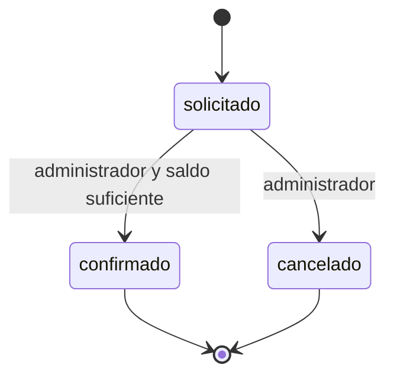

# LealCaf · Hito 2

API de fidelización de una cafetería desarrollada con Go, Gin, GORM y PostgreSQL. Conserva el trabajo existente: compras generan un punto por dólar completo, puntos vigentes seis meses y canjes compartidos entre sucursales Centro y Norte.

**Integrantes:** Fuentes Cedeño José Miguel y Anchundia Anchundia Luis Antonio · Web II A.

## Carpeta correcta

Todos los comandos siguientes se ejecutan dentro de **Trabajo_autonomo_Lealcaf_hito2**, donde están `main.go`, `go.mod`, `docs/` y `redocly.yaml`. Esta copia no contiene una subcarpeta `hito2/`. El repositorio Git está un nivel arriba y contiene otros trabajos: no ejecutar Go desde ese nivel para evaluar esta entrega.

```text
Trabajo_autonomo_Lealcaf_hito2/
├── main.go                   # Configuración y arranque
├── internal/fidelizacion/    # HTTP, servicio, repositorio, modelos y pruebas
├── scripts/iniciar-demo.ps1  # Iniciador Windows
├── docs/                    # Contrato, hoja, Bruno, evidencias y guion
├── .env.example
└── redocly.yaml
```

## Iniciar desde cero

1. Instalar **Go 1.27.1** o posterior compatible, PostgreSQL y Bruno. Node.js con npm se requiere para Redocly y Bruno CLI. `go version` debe coincidir con la versión mínima de `go.mod`.
2. Iniciar el servicio PostgreSQL. Usar la base existente **fidelizacion_db**. Solo en una instalación nueva, crear una base vacía con ese nombre en pgAdmin; no borrar, restaurar encima ni recrear una base con datos.
3. Crear el archivo privado sin reemplazar configuraciones anteriores:

```powershell
if (-not (Test-Path -LiteralPath '.env')) {
    Copy-Item -LiteralPath '.env.example' -Destination '.env'
}
```

4. Editar `.env`: completar `DB_USER` y `DB_PASSWORD` localmente; revisar `DB_HOST=localhost`, `DB_PORT=5432` y `DB_NAME=fidelizacion_db`. `PORT=8080` es el puerto HTTP. No compartir contraseñas ni subir `.env`.
5. Descargar y verificar dependencias:

```powershell
go mod download
go build ./...
go vet ./...
go test ./...
```

6. Ejecutar `.\Iniciar-Proyecto.cmd` o abrirlo con doble clic. Requiere Go y ejecuta siempre el código actual; genera una clave JWT aleatoria en `.env` cuando falta. Mantener abierta la terminal. Dirección: **http://localhost:8080**. Ctrl+C detiene el servidor.

Para usar `go run .` directamente, completar antes `JWT_SECRET` con al menos 32 bytes aleatorios. `JWT_TTL=1h` da tokens de una hora. Las variables de entorno del proceso tienen prioridad sobre `.env`; revisar las antiguas si la conexión no coincide. `ENV_FILE` permite elegir otra configuración privada.

**Estado local actualizado:** el alumno configuró `.env` e inició PostgreSQL y la API. La colección Bruno 0–6 pasó contra `localhost:8080`: 7/7 peticiones, 6/6 pruebas y 7/7 aserciones. Creó y confirmó un canje del cliente de demostración. El archivo privado no se distribuye; en otra computadora se debe configurar nuevamente la conexión. La verificación temporal anterior se conserva por separado.

## Datos y reglas

El arranque migra las seis entidades de negocio (Cliente, Compra, Recompensa, Canje, MovimientoPuntos y Sucursal) y Cuenta. Conserva registros existentes y atribuye las compras/canjes antiguos a Centro. `DEMO_DATA=true` añade un cliente ficticio dedicado, cuentas, puntos y un canje confirmado para el ensayo, dentro de una transacción. Reiniciar no duplica puntos ni renueva vencimientos. Un conflicto de cuentas aborta la preparación sin reemplazar credenciales.

| Usuario de prueba | Contraseña ficticia | Rol |
|---|---|---|
| cliente | cliente-2026 | cliente |
| admin | admin-2026 | administrador |

Las contraseñas se guardan con bcrypt. El JWT HS256 incluye identidad, rol, emisor, audiencia y caducidad; la API comprueba firma y cuenta vigente. `X-Rol` y `X-Cliente-ID` no autentican.



Confirmar descuenta puntos de forma atómica. Los bloqueos por cliente evitan gastar dos veces el saldo entre canjes simultáneos. Estados finales no se reabren: transición prohibida → **422**; JSON/destino inválido → **400**; sin token válido → **401**; rol sin permiso → **403**.

## Bruno y demostración

Abrir **docs/hito2_bruno/** como colección y seleccionar **Local**. Con servidor iniciado y `DEMO_DATA=true`, enviar **0** antes de cada ensayo: obtiene tokens e IDs reales y crea otro canje solicitado. Luego enviar **1, 2, 3, 4, 5 y 6** en orden: **401 → 200 con token → 200 → 403 → 200 → 422**. No pegar tokens ni cambiar IDs manualmente. Cada petición 5 consume puntos; la preparación 0 debe repetirse. Si cambia PORT, cambiar `baseUrl` antes del ensayo.

```powershell
npx.cmd @redocly/cli lint docs/openapi.yaml --format=stylish
```

Abrir [docs/api.html](docs/api.html) para visualizar el contrato incluso sin conexión. `redocly.yaml` activa `security-defined`. El contrato conserva las operaciones existentes y marca con **(plan)** las tres rutas futuras, sin implementarlas.

La demostración sigue el sorteo oficial: un integrante hace contrato y autenticación; el otro permisos, estados/pruebas y capas. El detalle de cinco minutos y las seis respuestas oficiales están en [el guion](docs/guion_hito2.md). Para defender las capas: `API.ActualizarEstadoCanje` interpreta HTTP, `Servicio.ActualizarEstadoCanje` y `ValidarTransicion` aplican reglas, `Repositorio.CambiarEstadoCanje` persiste.

## Pruebas y entrega

Las pruebas normales usan SQLite en memoria para aislar cada caso. La prueba adicional de concurrencia PostgreSQL se omite explícitamente si no se configura una conexión de pruebas. Para ejecutarla, usar exclusivamente una base desechable y un DSN en formato clave=valor:

```powershell
$env:LEALCAF_TEST_POSTGRES_DSN = 'host=127.0.0.1 port=15432 user=postgres dbname=fidelizacion_db sslmode=disable connect_timeout=5'
go test -count=1 -v ./...
Remove-Item Env:LEALCAF_TEST_POSTGRES_DSN
```

El puerto 15432 anterior corresponde a la instancia temporal de verificación, detenida al finalizar; no es un servidor que deba permanecer instalado. La prueba crea y limpia solo su esquema único `lealcaf_test_*`; no migra las tablas de `public`. La prueba comprueba migración idempotente y dos confirmaciones concurrentes con saldo para una.

- [Informe y matriz de cumplimiento](docs/validacion.md): estado inicial, cambios, comandos, resultados y pendientes.
- [Hoja del hito](docs/hito2_hoja.md): cuentas, peticiones, permisos y cumplimiento.
- [Modelo y API](docs/hito2_modelo.md): entidades, relaciones, estados y mapa de endpoints.
- [Guía técnica](docs/hito2_tecnico.md): configuración, pruebas y flujo de las solicitudes.
- [Decisiones](docs/decisiones.md): estructura, reglas y declaración de IA.
- [Colección Bruno](docs/hito2_bruno/README.md): pasos y variables.
- [Evidencias](docs/hito2_capturas/index.html): ocho capturas nuevas de Bruno Desktop, PNG anteriores y registros de pruebas, con procedencia diferenciada.


## Declaración de uso de herramientas de IA

Durante el desarrollo del proyecto LealCaf — Hito 2 se utilizó inteligencia artificial como herramienta de apoyo para revisar el código, detectar errores y proponer correcciones y mejoras.

