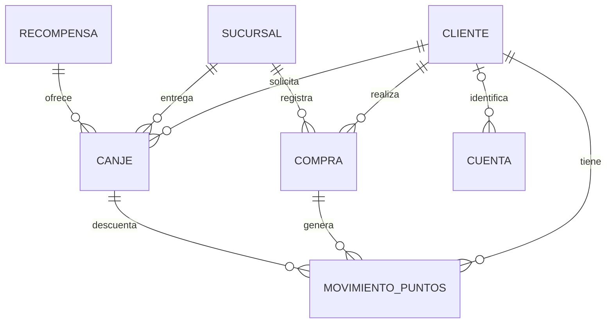
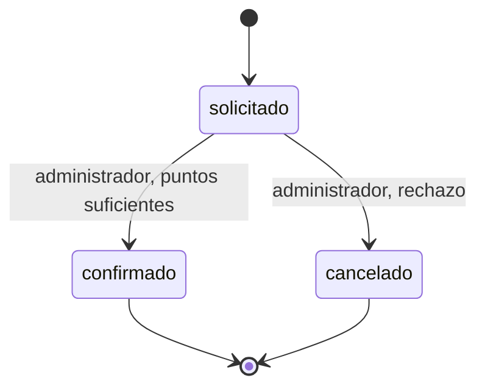

# Ficha del negocio · actualización para Hito 2

> Actualizado para Hito 2. El PDF `hito1_presentacion.pdf` conserva la presentación histórica; esta ficha describe la versión vigente.

**Pareja:** Fuentes Cedeño José Miguel · Anchundia Anchundia Luis Antonio
**Paralelo:** Aplicaciones Web II A
**Negocio en una línea:** Sistema web de fidelización por puntos para una cafetería: el administrador registra las compras, el cliente acumula puntos, consulta su historial y solicita recompensas que el administrador confirma.

## 1. Negocio de referencia

**DIPASO · programa TI POINTS** ([tipoints.dipaso.com.ec](https://tipoints.dipaso.com.ec/))

DIPASO es una empresa ecuatoriana que importa y comercializa productos de belleza (maquillaje, cuidado facial y capilar, uñas y accesorios) en tiendas físicas, página web y WhatsApp. Su programa de fidelización TI POINTS identifica al cliente con su cédula y le asigna 20 puntos por cada $50 de compra en productos válidos. Los puntos se consultan en la página de fidelización, tienen una vigencia de seis meses y se pueden canjear por cashback (mínimo 40 puntos) o por productos del catálogo de recompensas.

Tomamos TI POINTS como referencia y lo adaptamos a una cafetería. Mantenemos la identificación por cédula, la vigencia de seis meses y el canje por recompensas del catálogo. Cambiamos la regla de acumulación a 1 punto por cada dólar de la compra, porque el consumo por visita en una cafetería es pequeño y con la regla de DIPASO casi nadie llegaría a canjear.

**Enlace:** https://tipoints.dipaso.com.ec/ (sitio oficial del programa TI POINTS de DIPASO)

## 2. Caso de contraste

**Plenti (American Express, EE. UU.).** Lanzado en 2015, era un programa de coalición: el cliente acumulaba puntos en varios comercios aliados (Macy's, Rite Aid, Expedia, entre otros) y los canjeaba en cualquiera de ellos. En enero de 2018 varios aliados lo abandonaron y en abril de 2018 dejó de aceptar nuevos usuarios; cerró el 10 de julio de 2018. Según Retail Dive, menos de la mitad de los miembros había canjeado alguna vez una recompensa y, de ellos, la mayoría compraba en solo uno o dos de los aliados, lo que anula la ventaja de una coalición.

**Hipótesis de fondo:** el modelo de coalición dependía de que muchos comercios independientes se mantuvieran dentro y de que el cliente comprara en varios de ellos; al irse los aliados, los puntos perdieron utilidad. Nuestro programa es de un solo comercio: la cafetería controla sus clientes, sus compras, sus puntos y sus recompensas, y su costo es una recompensa que ella misma decide.

**Fuente:** https://www.retaildive.com/news/plenti-program-to-shut-down-in-july/521604/ (Retail Dive, "Plenti program to shut down in July"); también https://www.retaildive.com/news/macys-exits-plenti-loyalty-program/515976/ ("Macy's exits Plenti loyalty program").

## 3. Adaptación al Ecuador

1. **Identificación por cédula.** El programa de DIPASO identifica al cliente con su cédula, no con una cuenta de aplicación. *Efecto:* en el mostrador se busca al cliente por su número de cédula de 10 dígitos. *En el modelo:* `Cliente.Cedula` es obligatoria, de 10 caracteres y única.
2. **Comprobante de venta del SRI.** Toda venta tiene una factura con numeración de la forma 001-001-000000123, y el pago ocurre en caja (efectivo, transferencia o tarjeta) sin conexión con nuestro sistema. *Efecto:* el cliente no registra sus propias compras; las registra el administrador con el número de factura, y una misma factura no puede dar puntos dos veces. *En el modelo:* `Compra.NumeroFactura` es obligatorio y único, y solo el rol administrador puede crear compras.
3. **Vigencia de seis meses.** Los puntos de TI POINTS vencen a los seis meses de la compra que los generó. *Efecto:* el saldo no es un número guardado sino la suma de los puntos vigentes. *En el modelo (cambio principal):* cada movimiento de acumulación lleva `FechaVencimiento` y el saldo se calcula con los movimientos no vencidos.

**Qué cambió en el modelo por estas restricciones:** por la restricción 3, en lugar de guardar un saldo dentro de `Cliente`, se creó la entidad `MovimientoPuntos` con fecha de vencimiento. Así se sabe qué puntos siguen vigentes, cuáles vencieron y cuáles se gastaron en un canje. Por las restricciones 1 y 2, `Cliente.Cedula` y `Compra.NumeroFactura` son únicas y obligatorias.

## 4. Modelo de datos

**Persistencia actual:** PostgreSQL, base fidelizacion_db del Hito 1. La migración conserva los registros anteriores, agrega Sucursal y Cuenta y atribuye las compras y canjes antiguos a Centro. El cliente ficticio del ensayo se prepara aparte, sin asumir IDs fijos ni alterar el historial anterior.

Seis entidades de negocio: Cliente, Compra, MovimientoPuntos, Recompensa, Canje y Sucursal. Cuenta es una tabla separada para iniciar sesión, sin registro público ni CRUD de usuarios.

| Entidad | Función y referencias |
|---|---|
| Cliente | Identificación, contacto y estado activo del cliente. |
| Sucursal | ID, nombre único, dirección y estado activo. Centro=1; Norte=2 en la demostración. |
| Compra | ClienteID, SucursalID, fecha, total y número de factura único. |
| MovimientoPuntos | ClienteID; CompraID o CanjeID opcional; tipo, puntos y fechas. |
| Recompensa | Nombre, descripción, puntos necesarios y disponibilidad. |
| Canje | ClienteID, RecompensaID, SucursalID, puntos utilizados, fecha y estado. |
| Cuenta (autenticación) | Usuario único, hash bcrypt de contraseña, rol y ClienteID opcional. PasswordHash nunca sale en JSON. |

**Regla de sucursales:** los puntos y el catálogo pertenecen a una misma cafetería y se comparten entre sus locales. Compra.SucursalID identifica dónde ocurrió la compra; Canje.SucursalID indica dónde se retirará la recompensa. El cliente conserva un saldo global. La sucursal debe existir y estar activa al registrar una compra o solicitar un canje. Al migrar registros de Hito 1, la referencia nueva se asigna a la sucursal principal Centro (ID 1); su dirección es un dato de ejemplo que debe actualizarse.

### Relaciones



Cada compra y canje tiene exactamente un cliente y una sucursal; cada canje tiene una recompensa. Un movimiento puede provenir de una compra o de un canje. Una cuenta cliente identifica un cliente; la cuenta administrador no necesita ClienteID. Los structs vigentes completos son:

```go
package fidelizacion

import "time"

// Valores cerrados ("uno de:") que usa el dominio.
const (
	TipoAcumulacion = "acumulacion"
	TipoCanje       = "canje"

	EstadoSolicitado = "solicitado"
	EstadoConfirmado = "confirmado"
	EstadoCancelado  = "cancelado"

	RolCliente       = "cliente"
	RolAdministrador = "administrador"
)

// Reglas del programa (adaptadas del método de TI POINTS de DIPASO).
const (
	PuntosPorDolar = 1 // puntos que se ganan por cada dólar completo de la compra
	MesesVigencia  = 6 // vigencia de los puntos desde la compra que los generó
)

type Cliente struct {
	ID            uint      `gorm:"primaryKey" json:"id"`
	Cedula        string    `gorm:"type:varchar(10);not null;unique" json:"cedula"`
	Nombre        string    `gorm:"not null" json:"nombre"`
	Correo        string    `gorm:"not null;unique" json:"correo"`
	Telefono      string    `json:"telefono"`
	FechaRegistro time.Time `gorm:"autoCreateTime" json:"fecha_registro"`
	Activo        bool      `gorm:"not null;default:true" json:"activo"`
}

type Sucursal struct {
	ID        uint   `gorm:"primaryKey" json:"id"`
	Nombre    string `gorm:"not null;uniqueIndex" json:"nombre"`
	Direccion string `gorm:"not null" json:"direccion"`
	Activa    bool   `gorm:"not null;default:true" json:"activa"`
}

// Cuenta se usa exclusivamente para autenticacion, aparte del cliente del negocio.
type Cuenta struct {
	ID           uint     `gorm:"primaryKey" json:"id"`
	Usuario      string   `gorm:"not null;uniqueIndex" json:"usuario"`
	PasswordHash string   `gorm:"not null" json:"-"`
	Rol          string   `gorm:"not null" json:"rol"`
	ClienteID    *uint    `json:"cliente_id"`
	Cliente      *Cliente `gorm:"foreignKey:ClienteID" json:"-"`
}

type Compra struct {
	SucursalID    uint      `gorm:"not null;default:1;index" json:"sucursal_id"`
	Sucursal      Sucursal  `gorm:"foreignKey:SucursalID" json:"-"`
	ID            uint      `gorm:"primaryKey" json:"id"`
	ClienteID     uint      `gorm:"not null" json:"cliente_id"`
	Cliente       Cliente   `gorm:"foreignKey:ClienteID" json:"-"`
	Fecha         time.Time `gorm:"not null" json:"fecha"`
	Total         float64   `gorm:"not null" json:"total"`
	NumeroFactura string    `gorm:"not null;unique" json:"numero_factura"`
}

type Recompensa struct {
	ID               uint   `gorm:"primaryKey" json:"id"`
	Nombre           string `gorm:"not null" json:"nombre"`
	Descripcion      string `json:"descripcion"`
	PuntosNecesarios int    `gorm:"not null" json:"puntos_necesarios"`
	Activa           bool   `gorm:"not null;default:true" json:"activa"`
}

type Canje struct {
	SucursalID       uint       `gorm:"not null;default:1;index" json:"sucursal_id"`
	Sucursal         Sucursal   `gorm:"foreignKey:SucursalID" json:"-"`
	ID               uint       `gorm:"primaryKey" json:"id"`
	ClienteID        uint       `gorm:"not null" json:"cliente_id"`
	Cliente          Cliente    `gorm:"foreignKey:ClienteID" json:"-"`
	RecompensaID     uint       `gorm:"not null" json:"recompensa_id"`
	Recompensa       Recompensa `gorm:"foreignKey:RecompensaID" json:"-"`
	PuntosUtilizados int        `gorm:"not null" json:"puntos_utilizados"`
	Fecha            time.Time  `gorm:"not null" json:"fecha"`
	Estado           string     `gorm:"not null;default:solicitado" json:"estado"`
}

type MovimientoPuntos struct {
	ID               uint       `gorm:"primaryKey" json:"id"`
	ClienteID        uint       `gorm:"not null" json:"cliente_id"`
	Cliente          Cliente    `gorm:"foreignKey:ClienteID" json:"-"`
	CompraID         *uint      `json:"compra_id"`
	Compra           *Compra    `gorm:"foreignKey:CompraID" json:"-"`
	CanjeID          *uint      `json:"canje_id"`
	Canje            *Canje     `gorm:"foreignKey:CanjeID" json:"-"`
	Tipo             string     `gorm:"not null" json:"tipo"`
	Puntos           int        `gorm:"not null" json:"puntos"`
	Fecha            time.Time  `gorm:"not null" json:"fecha"`
	FechaVencimiento *time.Time `json:"fecha_vencimiento"`
}

```

Los campos opcionales usan punteros porque admiten NULL. Los valores cerrados se definen con constantes; la regla de transición pura vive en servicio.go. Total sigue siendo float64 como decisión académica heredada; el saldo mantiene el cálculo de movimientos vigente del Hito 1 y todavía no consume lotes por orden de vencimiento.

## 5. Máquina de estados

| De | A | Rol | Condición |
|---|---|---|---|
| solicitado (inicial) | confirmado | administrador | Cliente activo y saldo vigente suficiente. |
| solicitado | cancelado | administrador | Rechazo de la solicitud; no descuenta puntos. |

Confirmado y cancelado son finales. `confirmado → cancelado` está prohibido: la recompensa ya fue entregada y el descuento quedó registrado; una corrección requiere una operación nueva. También se prohíbe volver a solicitado o repetir la confirmación. `ValidarTransicion` en servicio.go no conoce HTTP ni la base. La confirmación revalida saldo y guarda cambio y movimiento negativo en una sola transacción. Una transición prohibida responde **422**; un destino desconocido responde **400**.



## 6. Roles y permisos

| Acción | Cliente | Administrador |
| --- | :---: | :---: |
| Consultar puntos e historial | solo los suyos | todos |
| Consultar recompensas activas | sí | sí |
| Registrar compra | no | sí |
| Solicitar canje | sí | no |
| Ver lista de canjes | no | todos |
| Ver un canje | solo los suyos | todos |
| Confirmar o cancelar canje | no | sí |

`POST /login` es público. La API comprueba un JWT HS256 firmado y obtiene de él la identidad; también verifica que la cuenta siga existiendo. El token dura una hora con JWT_TTL=1h. El middleware de rutas.go protege el grupo completo y SoloRol aplica permisos. X-Rol y X-Cliente-ID ya no autentican. Los roles son cliente y administrador; admin es el nombre del usuario de demostración.

## 7. Mapa de endpoints por rol

Todas las rutas del negocio requieren Bearer y pueden responder 401. Los errores internos responden 500 sin revelar detalles de la base.

| Endpoint | Rol | Éxito | Validación y errores |
|---|---|---|---|
| POST /login | Público | 200 y token | usuario/password obligatorios; 400 inválidos, 401 incorrectos. |
| POST /compras | administrador | 201 | cliente_id, sucursal_id, total>0, numero_factura; 400 inválidos, 403 rol, 404 inexistente, 409 factura repetida, 422 cliente/sucursal inactivos. |
| GET /clientes/{id}/puntos | cliente propio / administrador | 200 | 400 ID inválido; 403 ajeno; 404 inexistente. |
| GET /recompensas | ambos | 200 | Devuelve solo activas. |
| POST /canjes | cliente | 201 solicitado | recompensa_id y sucursal_id; cliente del JWT. 400 inválidos, 403 rol, 404 recurso/recompensa no disponible, 422 saldo insuficiente o cliente/sucursal inactivos. |
| GET /canjes | administrador | 200 | filtro estado opcional; 400 valor inválido, 403 rol. |
| GET /canjes/{id} | cliente propio / administrador | 200 | 400 ID inválido, 403 ajeno, 404 inexistente. |
| PATCH /canjes/{id}/estado | administrador | 200 | 400 destino desconocido, 403 rol, 404 inexistente, 422 transición prohibida/saldo insuficiente/cliente inactivo. |
| GET /clientes/{id} (plan) | cliente propio / administrador | 200 previsto | Documentado; todavía sin ruta programada. |
| GET /sucursales (plan) | ambos | 200 previsto | Documentado; todavía sin ruta programada. |
| GET /sucursales/{id} (plan) | ambos | 200 previsto | Documentado; todavía sin ruta programada. |

La especificación completa está en docs/openapi.yaml. Se conservan las operaciones del Hito 1; la entidad principal evaluada en Hito 2 es Canje. No se agregan nuevos CRUD de entidades adicionales.

## 8. Declaración de IA

- ChatGPT y Claude apoyaron la organización, revisión y código inicial del Hito 1, como se declaró en la ficha original.
- OpenAI Codex apoyó la actualización para Hito 2: Sucursal, autenticación con JWT, separación de capas, pruebas, contrato, colección de Bruno y documentación.

Los integrantes deben revisar y comprender las decisiones, realizar sus contribuciones y commits reales y declarar el uso de IA. El diseño es académico de la pareja; no describe la arquitectura interna de DIPASO.
