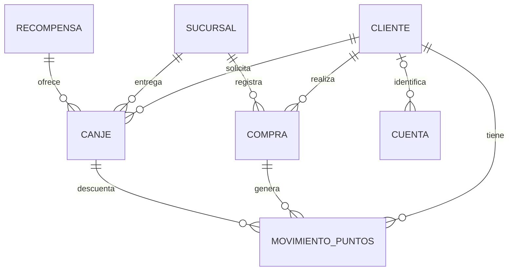
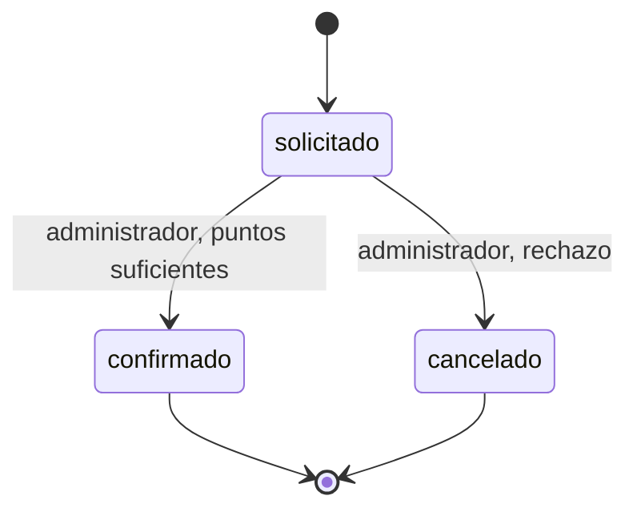

# Modelo y mapa de API · Hito 2

**LealCaf:** fidelización por puntos de una cafetería con sucursales. El cliente solicita recompensas y el administrador registra compras y gestiona canjes.

## 1. Modelo de datos

**Persistencia actual:** PostgreSQL, base fidelizacion_db existente. La migración conserva los registros anteriores, agrega Sucursal y Cuenta y atribuye las compras y canjes antiguos a Centro. El cliente ficticio del ensayo se prepara aparte, sin asumir IDs fijos ni alterar el historial anterior.

Seis entidades de negocio: Cliente, Compra, MovimientoPuntos, Recompensa, Canje y Sucursal. Cuenta es una tabla separada para iniciar sesión, sin registro público ni CRUD de usuarios.

| Entidad | Función y referencias |
|---|---|
| Cliente | Identificación, contacto y estado activo del cliente. |
| Sucursal | ID, nombre único, dirección y estado activo. Centro=1; Norte=2 en la demostración. |
| Compra | ClienteID, SucursalID, fecha, total y número de factura único. |
| MovimientoPuntos | ClienteID; CompraID o CanjeID opcional; tipo, puntos y fechas. |
| Recompensa | Nombre, descripción, puntos necesarios y disponibilidad. |
| Canje | ClienteID, RecompensaID, SucursalID, puntos utilizados, fecha y estado. |
| Cuenta (autenticación) | Usuario único, hash bcrypt de contraseña, rol y ClienteID opcional. PasswordHash nunca sale en JSON. |

**Regla de sucursales:** los puntos y el catálogo pertenecen a una misma cafetería y se comparten entre sus locales. Compra.SucursalID identifica dónde ocurrió la compra; Canje.SucursalID indica dónde se retirará la recompensa. El cliente conserva un saldo global. La sucursal debe existir y estar activa al registrar una compra o solicitar un canje. Al migrar registros existentes, la referencia nueva se asigna a la sucursal principal Centro (ID 1); su dirección es un dato de ejemplo que debe actualizarse.

### Relaciones

Cada compra y canje tiene exactamente un cliente y una sucursal; cada canje tiene una recompensa. Un movimiento puede provenir de una compra o de un canje. Una cuenta cliente identifica un cliente; la cuenta administrador no necesita ClienteID. Las definiciones completas y sus etiquetas GORM/JSON se mantienen en [modelos.go](../internal/fidelizacion/modelos.go):

Los campos opcionales usan punteros porque admiten NULL. Los valores cerrados se definen con constantes; la regla de transición pura vive en servicio.go. Total sigue siendo float64 como decisión académica heredada; el saldo se calcula mediante los movimientos vigentes y todavía no consume lotes por orden de vencimiento.

## 2. Máquina de estados

| De | A | Rol | Condición |
|---|---|---|---|
| solicitado (inicial) | confirmado | administrador | Cliente activo y saldo vigente suficiente. |
| solicitado | cancelado | administrador | Rechazo de la solicitud; no descuenta puntos. |

Confirmado y cancelado son finales. `confirmado → cancelado` está prohibido: la recompensa ya fue entregada y el descuento quedó registrado; una corrección requiere una operación nueva. También se prohíbe volver a solicitado o repetir la confirmación. `ValidarTransicion` en servicio.go no conoce HTTP ni la base. La confirmación revalida saldo y guarda cambio y movimiento negativo en una sola transacción. Una transición prohibida responde **422**; un destino desconocido responde **400**.

## 3. Roles y permisos

| Acción | Cliente | Administrador |
| --- | :---: | :---: |
| Consultar puntos e historial | solo los suyos | todos |
| Consultar recompensas activas | sí | sí |
| Registrar compra | no | sí |
| Solicitar canje | sí | no |
| Ver lista de canjes | no | todos |
| Ver un canje | solo los suyos | todos |
| Confirmar o cancelar canje | no | sí |

`POST /login` es público. La API comprueba un JWT HS256 firmado y obtiene de él la identidad; también verifica que la cuenta siga existiendo. El token dura una hora con JWT_TTL=1h. El middleware de rutas.go protege el grupo completo y SoloRol aplica permisos. X-Rol y X-Cliente-ID ya no autentican. Los roles son cliente y administrador; admin es el nombre del usuario de demostración.

## 4. Mapa de endpoints por rol

Todas las rutas del negocio requieren Bearer y pueden responder 401. Los errores internos responden 500 sin revelar detalles de la base.

| Endpoint | Rol | Éxito | Validación y errores |
|---|---|---|---|
| POST /login | Público | 200 y token | usuario/password obligatorios; 400 inválidos, 401 incorrectos. |
| POST /compras | administrador | 201 | cliente_id, sucursal_id, total>0, numero_factura; 400 inválidos, 403 rol, 404 inexistente, 409 factura repetida, 422 cliente/sucursal inactivos. |
| GET /clientes/{id}/puntos | cliente propio / administrador | 200 | 400 ID inválido; 403 ajeno; 404 inexistente. |
| GET /recompensas | ambos | 200 | Devuelve solo activas. |
| POST /canjes | cliente | 201 solicitado | recompensa_id y sucursal_id; cliente del JWT. 400 inválidos, 403 rol, 404 recurso/recompensa no disponible, 422 saldo insuficiente o cliente/sucursal inactivos. |
| GET /canjes | administrador | 200 | filtro estado opcional; 400 valor inválido, 403 rol. |
| GET /canjes/{id} | cliente propio / administrador | 200 | 400 ID inválido, 403 ajeno, 404 inexistente. |
| PATCH /canjes/{id}/estado | administrador | 200 | 400 destino desconocido, 403 rol, 404 inexistente, 422 transición prohibida/saldo insuficiente/cliente inactivo. |
| GET /clientes/{id} (plan) | cliente propio / administrador | 200 previsto | Documentado; todavía sin ruta programada. |
| GET /sucursales (plan) | ambos | 200 previsto | Documentado; todavía sin ruta programada. |
| GET /sucursales/{id} (plan) | ambos | 200 previsto | Documentado; todavía sin ruta programada. |

La especificación completa está en docs/openapi.yaml. Se conservan las operaciones ya implementadas; la entidad principal evaluada en Hito 2 es Canje. No se agregan nuevos CRUD de entidades adicionales.
