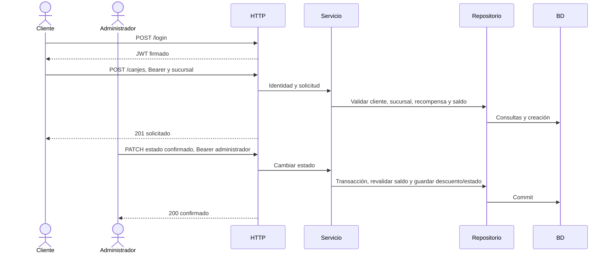

# Addendum técnico vigente · Hito 2

**Pareja:** Fuentes Cedeño José Miguel · Anchundia Anchundia Luis Antonio · Web II A, grupo P.

## A. Estructura

| Archivo | Responsabilidad |
|---|---|
| main.go | Configuración, conexión, migración, datos de ejemplo y arranque. |
| internal/fidelizacion/modelos.go | Seis entidades de negocio y Cuenta. |
| db.go | Conexión PostgreSQL, migración conservadora y demostración idempotente. |
| rutas.go | Grupo protegido por token y permisos por rol. |
| autenticacion.go | Login, bcrypt, emisión y validación JWT, adaptación HTTP del login. |
| manejadores.go | Adaptación de peticiones/respuestas; no consulta la base. |
| servicio.go | Reglas y coordinación del negocio; ValidarTransicion puro. |
| repositorio.go | Consultas y transacciones GORM. |
| *_test.go | Pruebas de negocio, autenticación, dominio, integración y migración. |
| docs/ | OpenAPI, HTML, hoja, Bruno, capturas, decisiones y guion. |
| Iniciar-Proyecto.cmd y scripts/iniciar-demo.ps1 | El iniciador principal llama al script interno para arrancar en Windows usando la configuración PostgreSQL de .env. |

## B. Configuración y secretos

La plantilla .env.example no contiene contraseña ni secreto de firma. La configuración PostgreSQL local se guarda en .env, excluido de Git. El iniciador genera JWT_SECRET aleatorio si está vacío o ausente, conservando las demás variables. No se distribuyen las credenciales reales. Las cuentas cliente/cliente-2026 y admin/admin-2026 son exclusivamente datos ficticios con DEMO_DATA=true; sus contraseñas se almacenan como hash bcrypt.

| Variable | Uso |
|---|---|
| DB_DRIVER | postgres; motor de ejecución del proyecto actual. |
| DB_HOST, DB_PORT, DB_USER, DB_PASSWORD, DB_NAME | Conexión original: localhost:5432, base fidelizacion_db. Usuario y contraseña permanecen locales. |
| ENV_FILE | Archivo de configuración opcional; el iniciador actual y go run usan .env. |
| PORT | Puerto HTTP, 8080 por defecto. Cambiar también baseUrl en Bruno. |
| JWT_SECRET | Clave local obligatoria de al menos 32 bytes; nunca en Git. |
| JWT_TTL | Duración del token; 1h para coincidir con la entrega. |
| DEMO_DATA | true carga datos ficticios una sola vez; otro valor no crea cuentas/clientes demo. |

La migración atribuye las compras y canjes antiguos a Sucursal 1 Centro. El nombre/dirección son datos iniciales que se deben revisar. La demostración prepara Norte y un cliente ficticio dedicado, utiliza una recompensa activa y crea un canje confirmado propio con ID generado por la base. Conserva los registros existentes. Reiniciar no vuelve a acreditar puntos, no renueva fechas y no reinicia estados.

## C. Pruebas

Las pruebas normales están en internal/fidelizacion/*_test.go y usan SQLite aislado. La prueba opcional postgres_test.go comprueba concurrencia e idempotencia con PostgreSQL cuando se configura LEALCAF_TEST_POSTGRES_DSN en una base desechable. Comprueban negocio, autenticación, permisos, firma y vencimiento, estados, puntos entre sucursales, rechazos sin descuentos parciales, migración de esquemas anteriores y siembra idempotente.

```powershell
go test ./...
npx @redocly/cli lint docs/openapi.yaml --format=stylish
```

TestTodasLasRutasDelNegocioExigenToken detecta si una ruta queda fuera del grupo protegido. TestIntegracionSeisPeticionesHito2 comprueba la secuencia completa. Ver docs/validacion.md para los resultados registrados de esta entrega; repetir en el equipo de exposición.

## D. Pantalla principal prevista

Gestión de canjes, rol administrador. Columnas: ID, cliente, recompensa, sucursal, puntos, fecha, estado y acción. Solo los solicitados ofrecen Confirmar/Cancelar. El boceto es diseño: la demostración del Hito 2 se realiza desde Bruno.

## E. Secuencia



## F. Preparación y evidencias

Abrir docs/hito2_bruno y entorno Local. Petición 0 obtiene ambos tokens y crea un canje nuevo; durante el turno se envían 1–6: 401, 200 con token, 200, 403, 200, 422. Tokens e ID se guardan solo en memoria. Preparar de nuevo antes de repetir. La transición prohibida usa canjeConfirmadoId, localizado por propietario y estado; no lo modifica ni presume que tenga ID 1.

Las evidencias están en docs/hito2_capturas/. Las capturas nuevas de Bruno Desktop sobre PostgreSQL local están en bruno_ui_0.jpg a bruno_ui_6.jpg y bruno_ui_resumen.jpg; el índice identifica los archivos históricos por separado. Los reportes de ensayos anteriores del Hito 2 se identifican como tales; las imágenes bruno_ui_*.jpg son las capturas nuevas de la interfaz. docs/decisiones.md explica las capas, sucursales y uso de IA; docs/guion_hito2.md prepara las preguntas. Las contribuciones humanas y el push deben realizarse con las cuentas reales de ambos integrantes.
