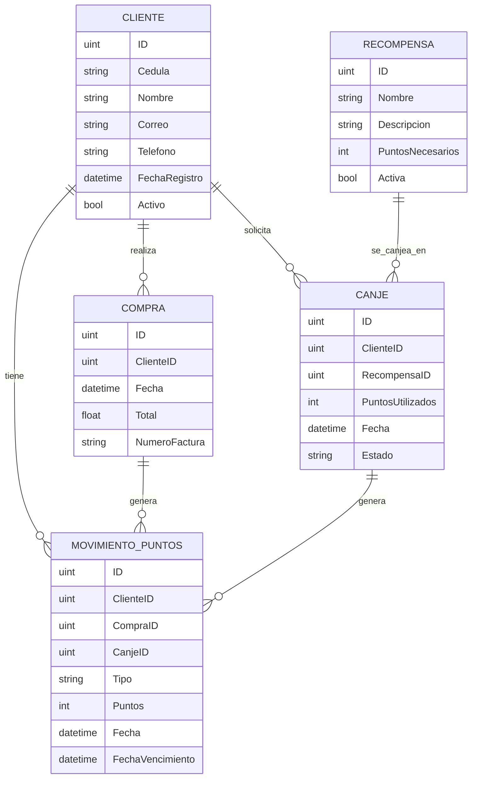
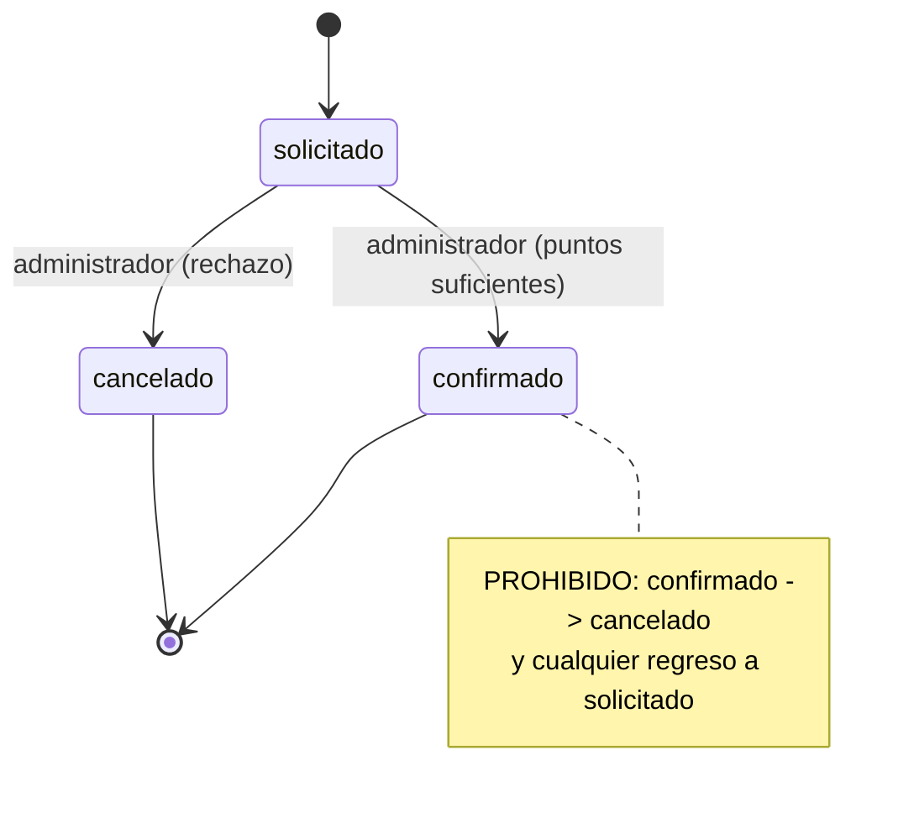

# Hito 1 · Ficha del negocio

**Pareja:** Fuentes Cedeño José Miguel · Anchundia Anchundia Luis Antonio
**Paralelo:** Aplicaciones Web II A
**Negocio en una línea:** Sistema web de fidelización por puntos para una cafetería: el administrador registra las compras, el cliente acumula puntos, consulta su historial y solicita recompensas que el administrador confirma.

## 1. Negocio de referencia

**DIPASO · programa TI POINTS** ([tipoints.dipaso.com.ec](https://tipoints.dipaso.com.ec/))

DIPASO es una empresa ecuatoriana que importa y comercializa productos de belleza (maquillaje, cuidado facial y capilar, uñas y accesorios) en tiendas físicas, página web y WhatsApp. Su programa de fidelización TI POINTS identifica al cliente con su cédula y le asigna 20 puntos por cada $50 de compra en productos válidos. Los puntos se consultan en la página de fidelización, tienen una vigencia de seis meses y se pueden canjear por cashback (mínimo 40 puntos) o por productos del catálogo de recompensas.

Siguiendo la indicación del docente de buscar una empresa ecuatoriana con un programa de fidelidad y su método, tomamos TI POINTS como referencia y lo adaptamos a una cafetería. Mantenemos la identificación por cédula, la vigencia de seis meses y el canje por recompensas del catálogo. Cambiamos la regla de acumulación a 1 punto por cada dólar de la compra, porque el consumo por visita en una cafetería es pequeño y con la regla de DIPASO casi nadie llegaría a canjear. Además, en la cafetería el administrador registra cada compra con su número de factura y confirma o cancela cada canje.

**Fuente:** sitio oficial del programa TI POINTS de DIPASO.

## 2. Caso de contraste

**Plenti (American Express, EE. UU.).** Lanzado en 2015, era un programa de coalición: el cliente acumulaba puntos en varios comercios aliados (Macy's, Rite Aid, Expedia, entre otros) y los canjeaba en cualquiera de ellos. En enero de 2018 varios aliados lo abandonaron y en abril de 2018 dejó de aceptar nuevos usuarios; cerró el 10 de julio de 2018. Una encuesta citada por Retail Dive indicó que la mitad de los consumidores consultados no conocía el programa y que la mayoría compraba en solo uno o dos de los aliados, lo que anula la ventaja de una coalición.

**Hipótesis de fondo:** el modelo de coalición dependía de que muchos comercios independientes se mantuvieran dentro y de que el cliente comprara en varios de ellos; al irse los aliados, los puntos perdieron utilidad. Nuestro programa es de un solo comercio: la cafetería controla sus clientes, sus compras, sus puntos y sus recompensas, y su costo es una recompensa que ella misma decide.

**Fuente:** Retail Dive, "Plenti program to shut down in July" y "Macy's exits Plenti loyalty program" (retaildive.com).

## 3. Adaptación al Ecuador

1. **Identificación por cédula.** El programa de DIPASO identifica al cliente con su cédula, no con una cuenta de aplicación. *Efecto:* en el mostrador se busca al cliente por su número de cédula de 10 dígitos. *En el modelo:* `Cliente.Cedula` es obligatoria, de 10 caracteres y única.
2. **Comprobante de venta del SRI.** Toda venta tiene una factura con numeración de la forma 001-001-000000123, y el pago ocurre en caja (efectivo, transferencia o tarjeta) sin conexión con nuestro sistema. *Efecto:* el cliente no registra sus propias compras; las registra el administrador con el número de factura, y una misma factura no puede dar puntos dos veces. *En el modelo:* `Compra.NumeroFactura` es obligatorio y único, y solo el rol administrador puede crear compras.
3. **Vigencia de seis meses.** Los puntos de TI POINTS vencen a los seis meses de la compra que los generó. *Efecto:* el saldo no es un número guardado sino la suma de los puntos vigentes. *En el modelo (cambio principal):* cada movimiento de acumulación lleva `FechaVencimiento` y el saldo se calcula con los movimientos no vencidos.

**Qué cambió en el modelo por la restricción 3:** en lugar de guardar un saldo dentro de `Cliente`, se creó la entidad `MovimientoPuntos` con fecha de vencimiento. Así se sabe qué puntos siguen vigentes, cuáles vencieron y cuáles se gastaron en un canje.

## 4. Modelo de datos

### Entidad: Cliente

| Atributo | Tipo | Obligatorio | Ejemplo |
| --- | --- | :---: | --- |
| ID | número entero | sí | 1 |
| Cedula | texto (10 dígitos, única) | sí | 0900000001 |
| Nombre | texto | sí | Juan Pérez |
| Correo | texto (único) | sí | juan@mail.com |
| Telefono | texto | no | 0991234567 |
| FechaRegistro | fecha y hora | sí | 01-10-2026 14:30 |
| Activo | sí/no | sí | sí |

### Entidad: Compra

| Atributo | Tipo | Obligatorio | Ejemplo |
| --- | --- | :---: | --- |
| ID | número entero | sí | 15 |
| ClienteID | referencia a Cliente | sí | 1 |
| Fecha | fecha y hora | sí | 01-10-2026 14:30 |
| Total | número decimal | sí | 50.75 |
| NumeroFactura | texto (única) | sí | 001-001-000000123 |

### Entidad: MovimientoPuntos

| Atributo | Tipo | Obligatorio | Ejemplo |
| --- | --- | :---: | --- |
| ID | número entero | sí | 30 |
| ClienteID | referencia a Cliente | sí | 1 |
| CompraID | referencia a Compra | no | 15 |
| CanjeID | referencia a Canje | no | 4 |
| Tipo | uno de: acumulacion, canje | sí | acumulacion |
| Puntos | número entero (negativo en canjes) | sí | 50 |
| Fecha | fecha y hora | sí | 01-10-2026 14:30 |
| FechaVencimiento | fecha y hora | no | 01-04-2027 14:30 |

### Entidad: Recompensa

| Atributo | Tipo | Obligatorio | Ejemplo |
| --- | --- | :---: | --- |
| ID | número entero | sí | 5 |
| Nombre | texto | sí | Café americano gratis |
| Descripcion | texto | no | Un café americano de 8 oz |
| PuntosNecesarios | número entero | sí | 40 |
| Activa | sí/no | sí | sí |

### Entidad: Canje

| Atributo | Tipo | Obligatorio | Ejemplo |
| --- | --- | :---: | --- |
| ID | número entero | sí | 4 |
| ClienteID | referencia a Cliente | sí | 1 |
| RecompensaID | referencia a Recompensa | sí | 5 |
| PuntosUtilizados | número entero | sí | 40 |
| Fecha | fecha y hora | sí | 01-10-2026 15:00 |
| Estado | uno de: solicitado, confirmado, cancelado | sí | solicitado |

### Relaciones

| Entidades | Cardinalidad | Frase |
| --- | :---: | --- |
| Cliente – Compra | 1:N | Un cliente realiza muchas compras; cada compra pertenece a un solo cliente. |
| Cliente – MovimientoPuntos | 1:N | Un cliente tiene muchos movimientos de puntos. |
| Compra – MovimientoPuntos | 1:N | Una compra genera un movimiento de acumulación (como máximo uno en esta versión). |
| Cliente – Canje | 1:N | Un cliente solicita muchos canjes. |
| Recompensa – Canje | 1:N | Una recompensa puede canjearse muchas veces. |
| Canje – MovimientoPuntos | 1:N | Un canje confirmado genera un movimiento de canje (como máximo uno en esta versión). |

### Structs en Go

Código completo en `fidelizacion/internal/fidelizacion/modelos.go`.

```go
type Cliente struct {
	ID            uint      `gorm:"primaryKey" json:"id"`
	Cedula        string    `gorm:"type:varchar(10);not null;unique" json:"cedula"`
	Nombre        string    `gorm:"not null" json:"nombre"`
	Correo        string    `gorm:"not null;unique" json:"correo"`
	Telefono      string    `json:"telefono"`
	FechaRegistro time.Time `gorm:"autoCreateTime" json:"fecha_registro"`
	Activo        bool      `gorm:"not null;default:true" json:"activo"`
}

type Compra struct {
	ID            uint      `gorm:"primaryKey" json:"id"`
	ClienteID     uint      `gorm:"not null" json:"cliente_id"`
	Cliente       Cliente   `gorm:"foreignKey:ClienteID" json:"-"`
	Fecha         time.Time `gorm:"not null" json:"fecha"`
	Total         float64   `gorm:"not null" json:"total"`
	NumeroFactura string    `gorm:"not null;unique" json:"numero_factura"`
}

type MovimientoPuntos struct {
	ID               uint       `gorm:"primaryKey" json:"id"`
	ClienteID        uint       `gorm:"not null" json:"cliente_id"`
	Cliente          Cliente    `gorm:"foreignKey:ClienteID" json:"-"`
	CompraID         *uint      `json:"compra_id"`
	Compra           *Compra    `gorm:"foreignKey:CompraID" json:"-"`
	CanjeID          *uint      `json:"canje_id"`
	Canje            *Canje     `gorm:"foreignKey:CanjeID" json:"-"`
	Tipo             string     `gorm:"not null" json:"tipo"`
	Puntos           int        `gorm:"not null" json:"puntos"`
	Fecha            time.Time  `gorm:"not null" json:"fecha"`
	FechaVencimiento *time.Time `json:"fecha_vencimiento"`
}

type Recompensa struct {
	ID               uint   `gorm:"primaryKey" json:"id"`
	Nombre           string `gorm:"not null" json:"nombre"`
	Descripcion      string `json:"descripcion"`
	PuntosNecesarios int    `gorm:"not null" json:"puntos_necesarios"`
	Activa           bool   `gorm:"not null;default:true" json:"activa"`
}

type Canje struct {
	ID               uint       `gorm:"primaryKey" json:"id"`
	ClienteID        uint       `gorm:"not null" json:"cliente_id"`
	Cliente          Cliente    `gorm:"foreignKey:ClienteID" json:"-"`
	RecompensaID     uint       `gorm:"not null" json:"recompensa_id"`
	Recompensa       Recompensa `gorm:"foreignKey:RecompensaID" json:"-"`
	PuntosUtilizados int        `gorm:"not null" json:"puntos_utilizados"`
	Fecha            time.Time  `gorm:"not null" json:"fecha"`
	Estado           string     `gorm:"not null;default:solicitado" json:"estado"`
}
```

**Dónde se validan los valores cerrados:** `Tipo` y `Estado` son `string` en el struct, pero sus valores permitidos son constantes en `modelos.go` (`TipoAcumulacion`, `TipoCanje`, `EstadoSolicitado`, `EstadoConfirmado`, `EstadoCancelado`). El estado se valida en `ActualizarEstadoCanje` (`manejadores.go`) y el tipo solo lo asigna el servidor.

**Decisión de tipos:** `FechaVencimiento`, `CompraID` y `CanjeID` son punteros (`*time.Time`, `*uint`) porque pueden ser nulos: un movimiento de canje no viene de una compra ni vence, y uno de acumulación no viene de un canje. `Total` es `float64` por simplicidad en esta primera versión; en una versión de producción conviene guardar el dinero en centavos enteros para evitar errores de redondeo.

### Diagrama del modelo completo



**Decisión discutible:** `MovimientoPuntos` es una entidad y no un campo `saldo` dentro de `Cliente`. Un saldo guardado no dice de dónde vienen los puntos ni cuándo vencen, y con la vigencia de seis meses se necesita saber cuáles puntos siguen vivos. Con movimientos se conserva el historial y el saldo se calcula. El costo es que cada consulta de saldo suma movimientos. Una limitación conocida: el saldo no consume los puntos más antiguos primero, y eso se resolvería en un hito posterior.

## 5. Máquina de estados

**Entidad con estados:** Canje

| Estado | Significado en el negocio |
| --- | --- |
| **solicitado** (inicial) | El cliente pidió una recompensa y tenía puntos suficientes. Todavía no se descuentan puntos. |
| confirmado | El administrador entregó la recompensa. Se registra el movimiento que descuenta los puntos. |
| cancelado | El administrador rechazó o anuló la solicitud. No se descuenta nada. |

### Transiciones

| De | A | Quién | Condición |
| --- | --- | --- | --- |
| solicitado | confirmado | administrador | El cliente sigue teniendo puntos vigentes suficientes al momento de confirmar. |
| solicitado | cancelado | administrador | Ninguna; basta el rechazo o la anulación. |

**Transición prohibida:** de `confirmado` (o de `cancelado`) no se vuelve a `solicitado` ni se pasa a otro estado. Un canje confirmado ya entregó la recompensa y descontó puntos; si se pudiera cancelar después, el cliente tendría la recompensa y sus puntos de vuelta. Si hubo un error, se registra una corrección con un movimiento nuevo. Se valida en `ActualizarEstadoCanje` (`manejadores.go`): si el canje no está en `solicitado`, responde `409`.

### Diagrama de estados



## 6. Roles y permisos

| Acción | Cliente | Administrador |
| --- | :---: | :---: |
| Consultar puntos e historial | solo los suyos | todos |
| Consultar recompensas activas | sí | sí |
| Registrar compra | no | sí |
| Solicitar canje | sí (propio) | no |
| Ver lista de canjes | no | todos |
| Confirmar o cancelar canje | no | sí |

El rol llega en el encabezado `X-Rol` y el cliente envía también `X-Cliente-ID`. Es una simplificación de este hito: todavía no hay inicio de sesión.

## 7. Mapa de endpoints por rol

| Endpoint | Rol que lo llama | Pantalla que lo consume | Qué devuelve | Qué valida | Código si falla |
| --- | --- | --- | --- | --- | --- |
| `POST /compras` | administrador | Registrar compra | `201` compra y puntos generados | Cliente existe y está activo, `total` > 0, factura no repetida | `400` datos inválidos o cliente inactivo · `404` cliente · `409` factura repetida · `403` rol |
| `GET /clientes/{id}/puntos` | cliente (el suyo), administrador | Mis puntos | `200` saldo vigente y movimientos | Que el cliente exista y que el cliente consulte solo lo suyo | `404` cliente · `403` ajeno |
| `GET /recompensas` | cliente, administrador | Recompensas | `200` recompensas activas | Solo activas | `401` sin rol |
| `POST /canjes` | cliente | Recompensas | `201` canje en estado `solicitado` | Recompensa activa y saldo ≥ puntos necesarios | `400` puntos insuficientes o datos inválidos · `404` recompensa · `403` rol |
| `GET /canjes` | administrador | Gestión de canjes | `200` lista (filtro `?estado=`) | Que `estado` sea uno de los tres valores | `400` estado no válido · `403` rol |
| `PATCH /canjes/{id}/estado` | administrador | Gestión de canjes | `200` canje actualizado | Estado nuevo ∈ {confirmado, cancelado}, canje en `solicitado`, saldo suficiente al confirmar | `400` estado no válido o puntos insuficientes · `404` canje · `409` transición no permitida · `403` rol |

### Matriz pantalla × endpoint

| Pantalla | POST /compras | GET /clientes/{id}/puntos | GET /recompensas | POST /canjes | GET /canjes | PATCH /canjes/{id}/estado |
| --- | :---: | :---: | :---: | :---: | :---: | :---: |
| Registrar compra (administrador) | ✓ | | | | | |
| Mis puntos (cliente) | | ✓ | | | | |
| Recompensas (cliente) | | | ✓ | ✓ | | |
| Gestión de canjes (administrador) | | | | | ✓ | ✓ |

**Endpoints que ya funcionan y en qué archivo:** los seis están implementados en `fidelizacion/internal/fidelizacion/manejadores.go`, registrados en `fidelizacion/internal/fidelizacion/rutas.go` y probados en `fidelizacion/internal/fidelizacion/fidelizacion_test.go`.

## 8. Declaración de IA

- **ChatGPT:** organización inicial de la información del negocio, propuesta del modelo de datos, relaciones y diagramas (secciones 1 a 5, borrador inicial de Miguel Fuentes).
- **Claude (Anthropic):** revisión de la ficha contra la rúbrica, ajuste del modelo y de los tipos, mapa de endpoints, código de los manejadores y pruebas (secciones 3 a 7 y addendum).

Los datos del programa TI POINTS salen de la información publicada por DIPASO. Las entidades, endpoints y reglas de esta ficha son un diseño académico de los integrantes y no la arquitectura interna de DIPASO.
