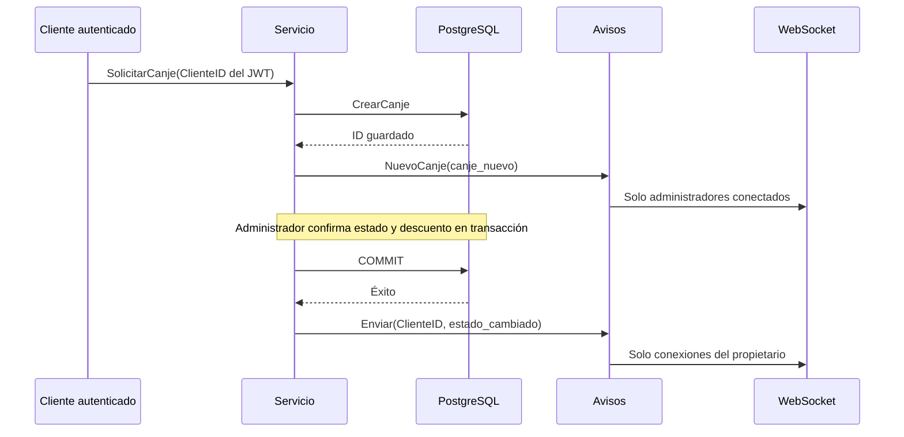

# Taller 13 · LealCafé

Base: `origin/taller12` en `c36d76e`, que incluye el aporte de José Miguel. Entrega parcial autorizada: los primeros seis commits de Luis, hasta `220f246`. El desarrollo completo queda local y en el ZIP de integración; no confundir ambos alcances.

Las evidencias oficiales están en esta carpeta, desde la raíz del repositorio. El módulo Go vigente es `Trabajo_autonomo_Lealcaf_hito2/`. Las decisiones se conservaron en ambos archivos históricos de decisiones, con la nueva sección Semana 13.

## Ejecución

Desde la raíz copia `.env.example` como `.env.taller13`, completa contraseñas ficticias privadas y JWT_SECRET aleatorio de al menos 32 bytes. Usa DB_NAME=lealcaf_taller13, DB_MIGRATION_USER=lealcaf_migrador y DB_API_PASSWORD para el rol lealcaf_api. No subas el archivo privado.

```powershell
docker compose --env-file .env.taller13 -f compose.yaml -f compose.taller13.yaml up -d --build
go -C Trabajo_autonomo_Lealcaf_hito2 build ./...
go -C Trabajo_autonomo_Lealcaf_hito2 test -count=1 ./...
go -C Trabajo_autonomo_Lealcaf_hito2 vet ./...
```

En la comprobación local, el entorno de Compose utiliza PORT=18085 y DB_LOCAL_PORT=15433. La base conserva el volumen `lealcaf-taller13_datos_postgres`. Para ejecutar Go en lugar de la API de Docker, usa un entorno privado con DB_HOST=127.0.0.1, DB_PORT=15433, DB_USER=lealcaf_api, DB_PASSWORD igual a DB_API_PASSWORD, PORT=18083 y BIND_HOST=127.0.0.1:

```powershell
$env:ENV_FILE=(Resolve-Path .env.taller13).Path
Set-Location Trabajo_autonomo_Lealcaf_hito2
go run . migrar
go run .
```

La migración necesita las credenciales del migrador; la API utiliza el rol restringido. `DEMO_DATA=true` siembra `cliente`, `cliente2` y `admin`; ambos clientes usan DEMO_CLIENT_PASSWORD y admin usa DEMO_ADMIN_PASSWORD. La siembra no reemplaza cuentas incompatibles. La cuenta cliente2 tiene identidad propia, sin compras ficticias añadidas a su saldo.

En otra terminal:

```powershell
Set-Location Trabajo_autonomo_Lealcaf_hito2/demo/taller13
go run servir.go
```

Abre `http://localhost:5173` en dos ventanas. La API se configura en el formulario: `http://127.0.0.1:18083` para Go o `http://127.0.0.1:18085` para Compose. Conecta cliente y cliente2. Abre la colección `Trabajo_autonomo_Lealcaf_hito2/docs/hito2_bruno` en Bruno y crea un entorno privado con baseUrl, clientePassword y adminPassword. Ejecuta la petición 0 y las seis siguientes, en orden y sin paralelismo. Espera un minuto entre recorridos de login. La petición 5 consume un canje nuevo; nunca reutilices uno confirmado.

## Pruebas y evidencias

`peticiones.md` reúne las tres vueltas reales de Bruno y sus capturas. `prueba_servicio.txt`, `prueba_websocket.txt` y `prueba_reto.txt` son salidas reales. `ws_*.txt` contienen curl contra la API; curl termina con código 28 tras obtener 101 porque el canal sigue abierto hasta su límite de dos segundos.

```powershell
python scripts/taller13_pruebas.py servicio
python scripts/taller13_pruebas.py websocket
python scripts/taller13_pruebas.py reto
python scripts/taller13_pruebas.py final
python scripts/taller13_handshake.py
python scripts/taller13_seis.py --env .env.taller13 --etapa comprobacion
```

El script de handshake lee `.env.taller13` privado desde la raíz y requiere curl.exe. Las pruebas unitarias e integraciones aisladas usan SQLite en memoria. Las salidas `pruebas_postgres.txt` corresponden a la ejecución adicional de los tests opcionales con LEALCAF_TEST_POSTGRES_DSN apuntando a la base Docker de demostración. Esos tests crean y limpian únicamente sus propios esquemas temporales. No se borraron bases ni volúmenes.

`aviso_navegador.png` muestra el canje 4 confirmado solo en cliente; `logs_avisos.txt` es de la misma ejecución, con ambos cierres 101 y JWT borrado antes del log. El reto se demuestra con dos administradores distintos y dos clientes en conexiones reales de un servidor de prueba; no se atribuye esa prueba a una captura de administradores en Chrome.

## Flujo para defender



La interfaz permite sustituir el transporte por un falso en pruebas. El mutex protege el mapa y las colas tienen límite. Si no hay conexión o la cola está llena, el aviso se pierde: REST es la fuente del estado real. Ver D1–D4 para vencimiento, cambios de rol y límites con varias instancias.
